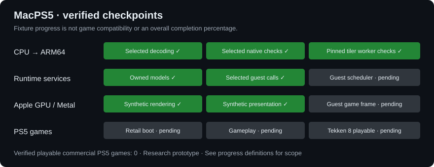

# About

**MacPS5** is an experimental PS5 compatibility project for Apple Silicon Macs, inspired by [AnyPS5](https://github.com/boykopovar/AnyPS5).

The project translates supported x86-64 guest instructions into ARM64, implements guest system services in Rust, and develops a graphics path targeting the Apple GPU through Metal. The initial hardware target is an M5 Pro, with a **16 GB unified-memory design budget**. Meeting that budget in a playable game has not been demonstrated.

Unlike AnyPS5's Linux/Windows relinking approach, MacPS5 needs CPU translation and an Apple graphics backend. It is a separate prototype, not an official AnyPS5 port. New implementation work uses Rust; older C++/Objective-C++ and Python files are retained migration references and test oracles.

[Build instructions](docs/BUILD.md), [Architecture and development history](DEVELOPMENT.md), [Rust implementation status](rust/README.md), [Progress definitions](docs/status/README.md), [Contributing](CONTRIBUTING.md)

## Status

  

* Bars track only the named, discrete checkpoints listed in the progress definitions. They are not a percentage of PS5 compatibility, CPU coverage, or total development completion. Green means the stated checkpoint was verified; gray means it remains unverified. No overall completion percentage is known.

[List of verified games](docs/COMPATIBILITY.md)

**No commercial PS5 game has booted or reached verified gameplay. Tekken 8 remains a target, not a supported title.**

The pinned homebrew startup resolves ten named dependency providers and the implemented mutex/thread-attribute imports. It stops at the missing `pthread_create` import and requests normal exit with status -1 before game main. Thread scheduling and process cleanup remain incomplete.

Focused ARM64 instruction and runtime checks, plus isolated Metal rendering/presentation checks, pass on the development machine. These do not establish game rendering, native-port performance, or full instruction/system compatibility. Experimental floating-point multiplication is not yet enabled in the translator. Full-width worker arguments and returns pass native checks, including suspension and lazy translation; this does not implement thread scheduling.

Unsupported operations and invalid guest memory stop explicitly rather than silently reporting success.

## Compatibility

See the [compatibility list](docs/COMPATIBILITY.md) for the exact testing boundary. PC game files cannot establish compatibility with the PS5 executable or system interfaces.

## Input mapping

Controller, keyboard and IME interfaces have initial implementations and fixtures. A complete playable input loop and user-configurable mapping interface are not available yet. See [implementation status](rust/README.md).

## Disclaimer

This project is for interoperability research and compatibility development. Game files, firmware, cryptographic keys and proprietary SDKs are not included. Supply your own appropriately obtained test inputs. The repository does not provide a PlayStation Store downloader or a way to launch retail games today.

## License

GNU General Public License version 2 only; see [LICENSE](LICENSE). Third-party code retains its applicable notices and licenses. See [acknowledgments](NOTICE.md).
